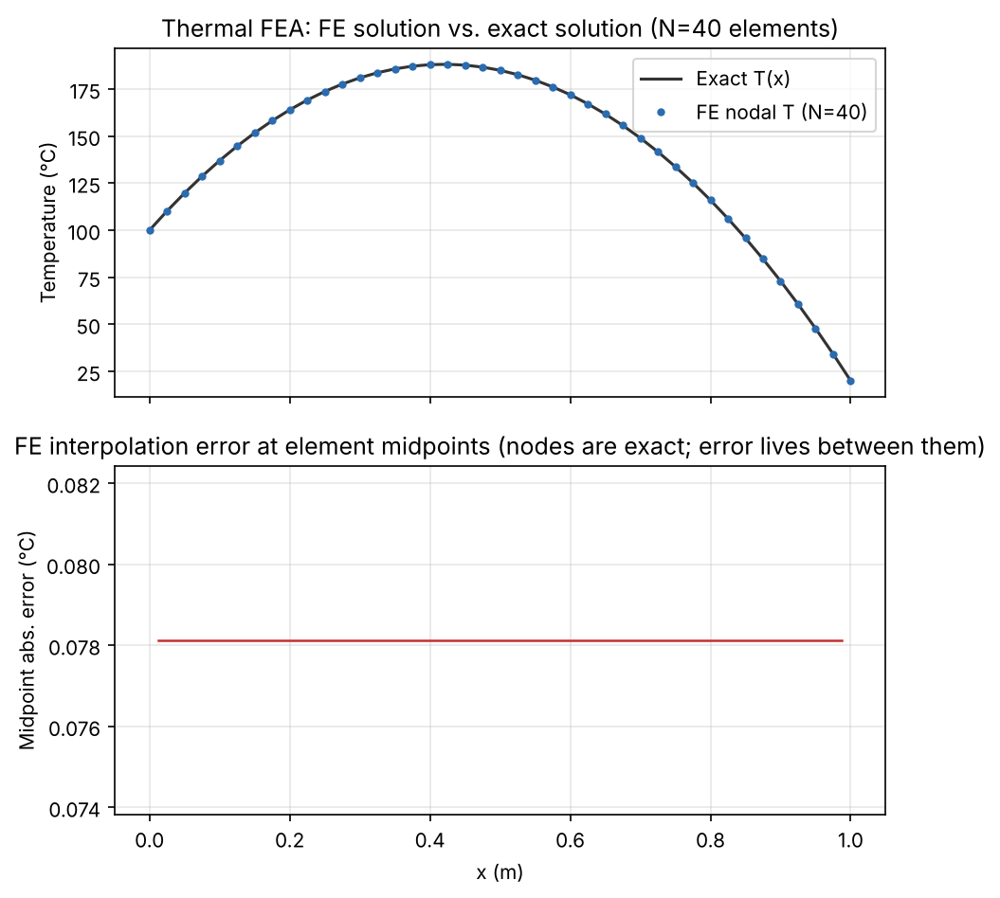
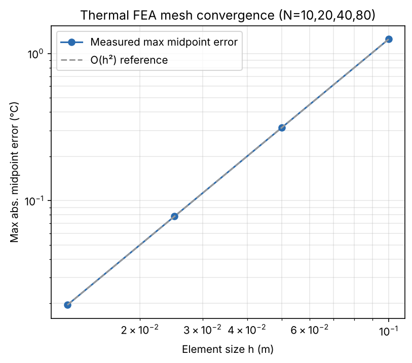
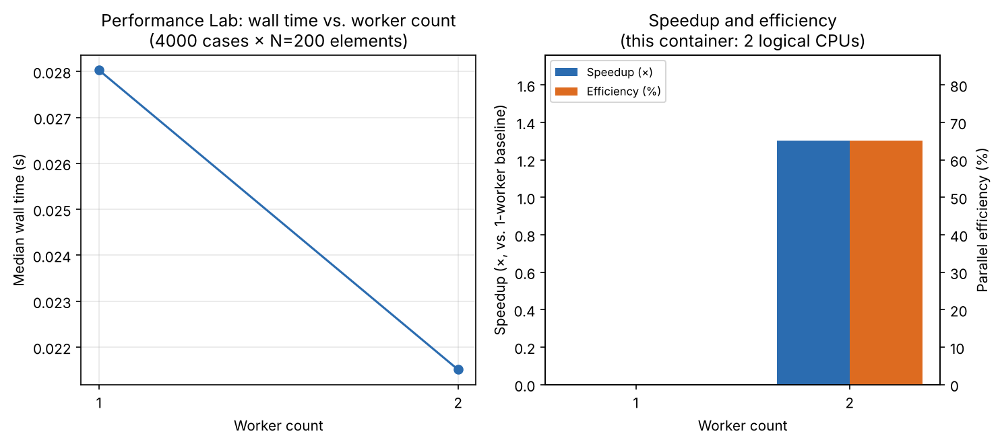
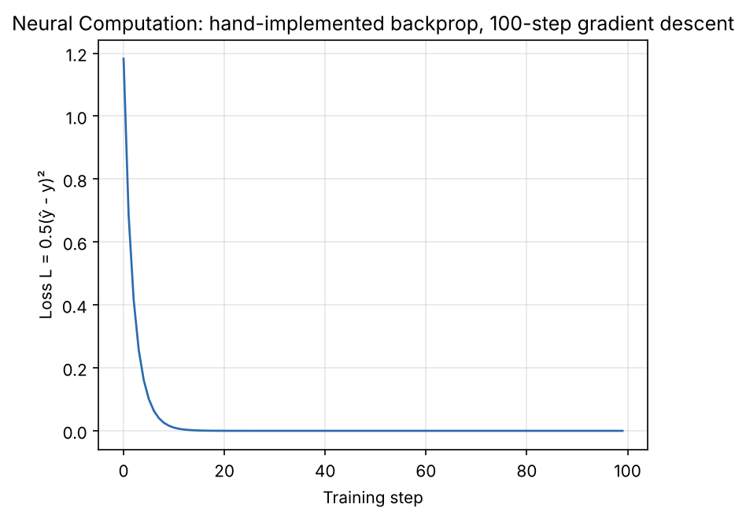
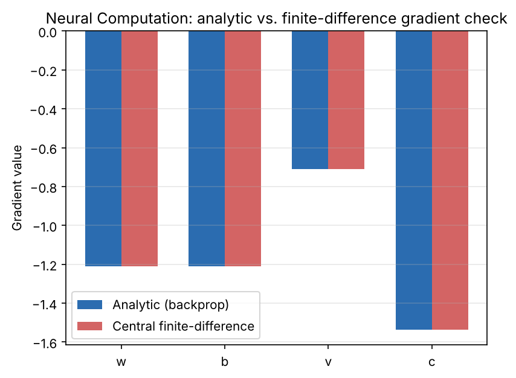
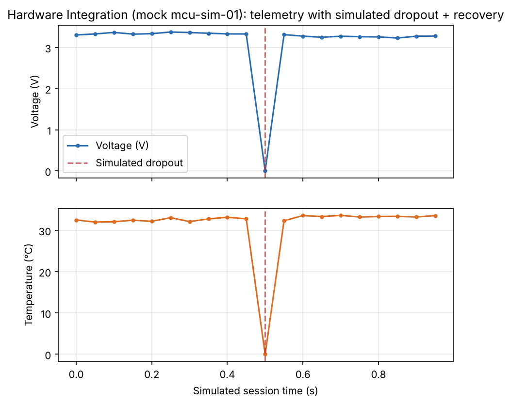

# NEXUS — Engineering Intelligence Workbench
### Technical Report
PASS Science Works R&D Internship 2026–2027 (Web & Software Development track)
Candidate: Gaayathri Muralidharan
Repository: https://github.com/jagaspeakstou-netizen/nexus-workbench


## 1. Overview

NEXUS is a C++17/React engineering simulation workbench: six independent
engineering-discipline modules behind one HTTP API and one web UI, plus
a native Windows packaging path. Every number in this report (test
counts, CI results, convergence rates, benchmark timings) is drawn from
a reproducible run recorded in this repository — not estimated. Where a
limitation was found, it is disclosed here and in that module's
architecture doc rather than edited out.

**Stack:** C++17 core (`backend/`, static lib `nexus_core` + a thin
`cpp-httplib`/`nlohmann::json` HTTP layer); React + TypeScript + Vite +
Tailwind frontend (`frontend/`); GoogleTest for all backend testing.

**Module status** — all 6 modules implemented and tested (source of
truth: `backend/src/core/status.cpp`, the same code the UI's Overview
page renders — not a separately maintained claim). **63/63 backend
tests pass**, on this project's Linux container (plain, strict-warnings,
and ASan+UBSan builds) and on a real `windows-latest` GitHub Actions
runner (§5, §6).


## 2. Module summaries

Full derivations live in each module's own architecture doc (linked);
this section gives only the essential, evidenced result.

### 2.1 Geometry Lab
*Full doc: [`docs/architecture/geometry_lab.md`](../architecture/geometry_lab.md)*

Hand-rolled ASCII STL and ANSYS nodal-CSV parsers with strict
grammar/schema validation (malformed input rejected with a specific,
located error). Three.js viewers (`MeshViewer`, `PointCloudViewer`)
render the parsed JSON with orbit/fit-to-view and click-to-inspect.

### 2.2 Thermal Analysis
*Full doc: [`docs/architecture/thermal_fea.md`](../architecture/thermal_fea.md)*

1D steady-state FEA for `-d/dx(kA dT/dx) = qA`, symmetric-elimination
Dirichlet BCs, Thomas-algorithm tridiagonal solve. Nodally exact for
this constant-source problem. Midpoint FE-interpolation error at
N=10/20/40/80 — **1.25, 0.3125, 0.078125, 0.01953125 °C** — each exactly
4× smaller than the last (confirmed O(h²) convergence, checked against
an independently-derived closed form, not just the solver's own output).



### 2.3 Performance Lab
*Full doc: [`docs/architecture/performance_lab.md`](../architecture/performance_lab.md)*

Reproducible fixed-seed batch of thermal solves, serial vs. a bounded
`std::thread` pool, deterministic result ordering, exact
serial/parallel numerical agreement (**0.0 °C difference measured**).
Worker count capped to `hardware_concurrency()`. This container's 2
logical CPUs give **1.30× speedup / 65.1% efficiency at 2 workers**
(4000 cases × N=200); an earlier under-scaled benchmark (40×N=40)
measured *slower* parallel execution — a genuine mistake found, fixed,
and left in the record rather than removed.



### 2.4 Neural Computation
*Full doc: [`docs/architecture/backprop.md`](../architecture/backprop.md)*

Hand-derived backprop (no autodiff) for one hidden unit,
`x → (w,b) → z → tanh → h → (v,c) → ŷ`, `L = 0.5(ŷ-y)²`. Every analytic
gradient checked against central finite differences (`ε=1e-6`,
tol `1e-5`), with a negative-control test proving the check can
actually fail. 100-step gradient descent converges loss 1.18 → ~0.



### 2.5 Hardware Integration
*Full doc: [`docs/architecture/hardware_mocks.md`](../architecture/hardware_mocks.md)*

**No physical hardware is attached.** Deterministic (seeded) simulator:
discover → connect (scripted retry) → telemetry (scripted dropout +
auto-reconnect) → pinout, for Microcontroller/FPGA/JTAG. Disclosed at
every layer (API field, frontend banner, header comment, doc title) —
never presented as real telemetry. A genuine Windows-only compile
failure was found and fixed here (§6.2): MSVC's `#define interface
struct` COM macro collided with a field literally named `interface`;
fixed by renaming the C++ identifier.



### 2.6 Windows packaging
*Full doc: [`docs/packaging/windows.md`](../packaging/windows.md)*

A native WebView2 shell (`Launch.exe`) spawns `nexus_server.exe` and
displays the built frontend — no terminal/admin/internet/install step
on a clean Windows 11 machine. Statically-linked MSVC CRT. Real
launch defects (missing `CoInitializeEx`; blank `file://` page, §6) were
found and fixed here — re-verification pending.


## 3. Architecture

`frontend/` (React+TS, one page per module) ⟷ HTTP/JSON ⟷
`backend/src/api/main.cpp` (`nexus_server`) ⟷ `nexus_core` (static lib:
geometry/thermal/performance/neural/hardware/status). All computation
lives in `nexus_core`; `main.cpp` only wires HTTP routes to it, so every
module is unit-testable without the HTTP layer — the architecture every
`test_<module>.cpp` exercises directly. On Windows, `windows/launcher/`
adds a `nexus_launcher` (`Launch.exe`) target that spawns
`nexus_server.exe` and hosts the built frontend in WebView2 (§2.6).

## 4. Build and run

Full prerequisites/commands: top-level [`README.md`](../../README.md).

```bash
cd backend && cmake -S . -B build -DCMAKE_BUILD_TYPE=Release && cmake --build build -j
./build/nexus_server 8787                       # backend
cd backend/build && ctest --output-on-failure    # tests
cd frontend && npm install && npm run dev        # frontend
```

Windows: run `Launch.exe` from a built release, or build from source in
VS Code/Antigravity per
[`docs/packaging/windows.md`](../packaging/windows.md#editor-based-source-build-vs-code-or-antigravity).


## 5. Validation (Day 11 pass)

Full detail: [`docs/architecture/validation.md`](../architecture/validation.md).
Summary of what was actually run, with results:

| Check | Result |
|---|---|
| `-Wall -Wextra -Wpedantic -Wshadow` | 1 real bug found and fixed (a shadowed loop variable in `hardware_mocks.cpp`); 0 warnings after |
| AddressSanitizer + UndefinedBehaviorSanitizer | 63/63 tests clean, no leaks |
| ThreadSanitizer | 19 concurrency-relevant tests + the real 4000-case multicore benchmark CLI run, clean, bit-exact serial/parallel agreement |
| Edge-case audit | 2 genuine Thermal gaps filled (minimum-valid N=1 mesh; zero-heat-source exact-linear regime); 1 genuine Performance bug found and fixed (`run_batch_parallel(num_workers<=0)` previously returned silently-unpopulated zero results instead of erroring — now throws `std::invalid_argument`) |

Every finding above is backed by a named test or a quoted compiler/tool
log in `validation.md` — this section is a summary of that document, not
a separate claim.


## 6. Cross-platform CI evidence (GitHub Actions, `windows-latest`)

This dev environment is Linux; Windows behavior is verified only via
`.github/workflows/windows-build.yml` on GitHub-hosted Windows runners.

| Run | Commit | Result | Note |
|---|---|---|---|
| [41338201277](https://github.com/jagaspeakstou-netizen/nexus-workbench/actions/runs/41338201277) | — | Failed | Hardcoded CMake generator didn't match runner's installed VS — fixed by auto-detect |
| [41338521566](https://github.com/jagaspeakstou-netizen/nexus-workbench/actions/runs/41338521566) | — | Tests passed; launch did not | 43/43 tests. Screenshot, personally inspected for the first time 2026-11-02, showed a WebView2 startup-error dialog the old "process alive" gate missed. |
| — | `dec8171` | Failed | `interface`/COM macro collision (§2.5) |
| — | `11138f1` | Passed | 60/60 tests, fix verified |
| [41373581581](https://github.com/jagaspeakstou-netizen/nexus-workbench/actions/runs/41373581581) | `01a865e` | Passed | 63/63 tests, incl. new `BatchRun.RejectsInvalidWorkerCount` — confirmed via `gh run view --log`, not the checkmark alone |
| [41383120271](https://github.com/jagaspeakstou-netizen/nexus-workbench/actions/runs/41383120271) | `f621e83` | Passed; window blank | 63/63 tests. `CoInitializeEx` fixed the error dialog, but the screenshot shows a blank window (`file://` cannot load the Vite bundle). Fixed by serving the SPA over HTTP; CI now checks rendered pixels. Re-verification pending. [`AI_USE_LOG.md`](AI_USE_LOG.md) |


## 7. End-to-end UI verification

Full detail: [`E2E_CHECK.md`](E2E_CHECK.md); timestamped
screenshot-and-log walkthrough: [`DEMO_WALKTHROUGH.md`](DEMO_WALKTHROUGH.md).
Real Playwright/Chromium driven against the **built** frontend
(`vite preview`, not the dev server) talking to the **live** backend —
every sidebar page cold-loaded with zero console/page errors, plus
real interactive flows (load sample geometry, re-run neural training,
re-run hardware sequence), also zero errors. This check found and
fixed a real shipped bug: "Validation & Tests" and "Documentation"
were hardcoded to claim "not implemented yet," stale since Day 11/14 —
replaced with a page reading the same live `/api/status` as Overview.


## 8. Known limitations (disclosed, not hidden)

- **Hardware Integration is fully simulated** — no physical device attached (§2.5).
- **Performance Lab's absolute timings are container-specific** (2 logical CPUs, shared/virtualized host); two otherwise-identical runs measured 1.30×/65% and 1.80×/90%. The 0.0 °C numerical-agreement result is the load-bearing claim, not the absolute speedup figure.
- **The Windows standalone launch is not yet re-verified after the blank-window fix** (§6) — two earlier "confirmed" claims were wrong, each caught only by looking at a CI screenshot. No claim is made until a fresh run's screenshot shows the rendered UI.
- **The packaged `Launch.exe`/`nexus_server.exe` binary built by CI could not be downloaded into this dev environment** (Azure Blob network restriction) — the candidate pulled it manually from the Actions UI instead.
- **The e2e UI check (§7) runs on demand, not wired into CI as an automated gate** — a real remaining gap.


## 9. Reproducing this report's evidence

```bash
cd backend && cmake --build build -j
./build/nexus_thermal_export ../results/csv && ./build/nexus_neural_export ../results/csv
./build/nexus_hardware_export ../results/csv && ./build/nexus_performance_export ../results/benchmarks
python3 scripts/generate_plots.py        # regenerate every plot above
cd backend/build && ctest --output-on-failure
```

Full reproduction list (sanitizers, e2e check, challenge test, etc.):
[`APPENDIX.md` §A.4](APPENDIX.md).
